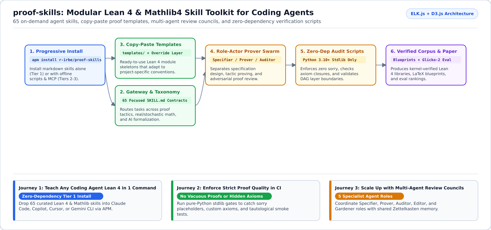
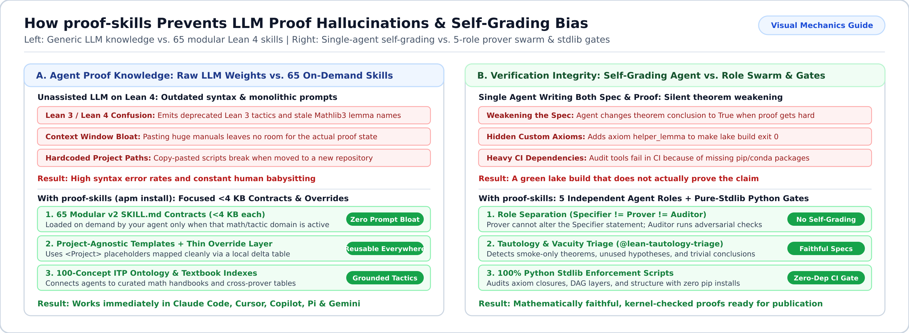

<div align="center">

# proof-skills

**Give any AI coding agent 65 battle-tested Lean 4 and Mathlib4 proof skills, copy-paste templates, and zero-dependency verification gates.**

[](LICENSE)
[](https://github.com/leanprover/lean4)
[](https://github.com/leanprover-community/mathlib4)
[](https://github.com/microsoft/apm)
[](skills/)

</div>

`proof-skills` (forked and extended from [`leanprover/skills`](https://github.com/leanprover/skills)) is an [Agent Skills](https://agentskills.io) toolkit that teaches AI assistants (Claude Code, Cursor, GitHub Copilot, Antigravity, Gemini CLI, OpenCode, and Codex) how to write, repair, review, and audit Lean 4 formal proofs.



---

## Why Use `proof-skills`? (What Problem Does It Solve?)

Out-of-the-box LLMs struggle with Lean 4 because their training data mixes old Lean 3 syntax, outdated Mathlib lemma names, and unverified shortcuts:

1. **Agents hallucinate Lean 3 tactics or get stuck on basic errors**: `proof-skills` gives your agent 65 focused, on-demand skill guides (`<4 KB` each) covering modern Lean 4 tactics, toolchain setup, real/stochastic analysis, dynamical systems, and cross-prover porting from Coq or Isabelle.
2. **Agents "cheat" by leaving `sorry`, adding custom `axiom` declarations, or proving vacuous `True` theorems**: Our built-in verification scripts (100% Python standard library, zero `pip` installs needed) catch hidden axioms, `sorry` placeholders, and tautological smoke tests automatically.
3. **One agent doing everything leads to self-grading bias**: When the same agent writes the theorem statement, proves it, and reviews it, it often weakens the theorem to make the proof pass. `proof-skills` provides 5 separate agent roles (*Specifier*, *Prover*, *Auditor*, *Editor*, *Gardener*) so specification and auditing stay independent.

> **How this extends upstream [`leanprover/skills`](https://github.com/leanprover/skills)**: Building on the upstream Lean skill format, `r-irbe/proof-skills` expands the catalog to **65 v2 `SKILL.md` contracts**, adds **5 independent agent roles** (`specifier`, `prover`, `auditor`, `editor`, `gardener`) to eliminate self-grading bias, bundles **pure Python stdlib CI enforcement scripts** (zero `pip` dependencies), and embeds the **21-tool `lean-lsp` MCP server** and **100-concept ITP Ontology**.



---

## Start in 2 Minutes (Pick Your Setup Tier)

You only need to install as much as your workflow requires:

### Option A: Just the Agent Skills (Zero Dependencies)

If you just want your coding agent to write better Lean 4 proofs immediately, install the markdown skills via [APM](https://github.com/microsoft/apm):

```bash
# Install all 65 skills into Claude Code, Copilot, Cursor, or OpenCode
apm install r-irbe/proof-skills

# Or install a single skill (e.g. interactive proof writing)
apm install r-irbe/proof-skills --skill lean-proof
```

### Option B: Skills + Offline Verification & Blueprint Scripts (Python Stdlib Only)

Clone the repository to run our zero-dependency Python 3.10+ audit scripts, tactic advisor (`altproof`), and DAG visualizers:

```bash
git clone --recurse-submodules https://github.com/r-irbe/proof-skills
cd proof-skills
./scripts/check-structure
```

### Option C: Full Stack with 21-Tool `lean-lsp` MCP Server

Bootstrap submodules, optional Python packages, and the embedded `lean-lsp` MCP server (`tools/lean-lsp-mcp`) in one command:

```bash
bash scripts/setup-env.sh --doctor   # Non-mutating health check
bash scripts/setup-env.sh            # Full setup (or: apm run setup)
```

---

## Adapt to Your Use Case (Customer Journeys)

<details open>
<summary><b>1. Individual Prover -- Write & Repair Lean 4 Proofs Faster</b></summary>

- **Who this is for**: Mathematicians, CS students, and engineers formalizing theorems in Lean 4 or upgrading a project to a newer Mathlib version.
- **Recommended skills**: `@lean-proof` (step-by-step tactic proving), `@lean-proof-repair` (fixing broken proofs after Mathlib bumps), `@lean-research` (finding existing Mathlib lemmas), and `@lean-mwe` (extracting minimal working examples).
</details>

<details>
<summary><b>2. Engineering & Verification Teams -- Enforce Zero-Sorry Quality Gates in CI</b></summary>

- **Who this is for**: Teams using Lean 4 to verify critical algorithms, protocols, or AI safety properties who need a trustworthy CI gate.
- **Recommended skills & tools**: `@lean-axiom-closure` (verifies `#print axioms` contains no `sorryAx` or custom axioms), `@lean-tautology-triage` (flags vacuous or trivial theorems), and `@lean-enforcement`.
- **Project-agnostic overrides**: Templates use `<Project>` placeholders so your repository can supply a thin override table without forking the skill library.
</details>

<details>
<summary><b>3. Multi-Agent Prover Swarms & Academic Blueprints</b></summary>

- **Who this is for**: Research groups running multi-agent formalization campaigns or converting Lean 4 projects into LaTeX papers and interactive DAG blueprints.
- **Recommended skills**: `@lean-review-council` (5-member adversarial proof audit), `@lean-blueprint` + `@lean-dag-visualizer`, `@itp-cross-porting` (translating Coq/Isabelle/HOL Light proofs), and `@lean-zettelkasten`.
</details>

---

## What Is Inside & Reference Docs

<details>
<summary><b>View repository directory map and CI validation scripts</b></summary>

| Path | What It Contains |
| :--- | :--- |
| [`skills/`](skills/) | 65 modular `SKILL.md` contracts paired with deep-dive `references/*-handbook.md` guides. |
| [`agents/`](agents/) | 5 role containers (`specifier`, `prover`, `auditor`, `editor`, `gardener`) + 23 domain specialist overlays. |
| [`tools/lean-lsp-mcp/`](tools/lean-lsp-mcp/) | Embedded `lean-lsp` MCP server + Rust/WASM `lean-analyzer` (`bin/lean-lsp-mcp.js` auto-bootstraps on first run). |
| [`templates/`](templates/) | Copy-pasteable Lean 4 module skeletons (`templates/00-CONVENTIONS.md`). |
| [`vendor/itp-ontology/`](vendor/itp-ontology/) | 100-concept ITP Ontology, 10 textbook JSON indexes, and 6-prover tactic concordance. |
| [`scripts/`](scripts/) | `setup-env.sh`, `check-structure`, `lint/apm_validate.py`, `skill-audit/check_conformance.py`, and Glicko-2 evaluation harnesses. |

### Key Guides
- [**User & Operator Guide (`USER_GUIDE.md`)**](USER_GUIDE.md) -- Detailed installation tiers, MCP wiring, and CI scripts.
- [**Skill Taxonomy (`TAXONOMY.md`)**](TAXONOMY.md), [**Agent Roles (`ROLES.md`)**](ROLES.md), and [**Domain Facets (`FACETS.md`)**](FACETS.md).
- [**Agent Operating Contract (`AGENTS.md`)**](AGENTS.md) -- Reversibility tiers and dispatch rules.
</details>

---

<div align="center">
<sub>
Apache-2.0 · Authored by <a href="https://github.com/r-irbe">@r-irbe</a> · Issues & PRs welcome at <a href="https://github.com/r-irbe/proof-skills">github.com/r-irbe/proof-skills</a>
</sub>
</div>
